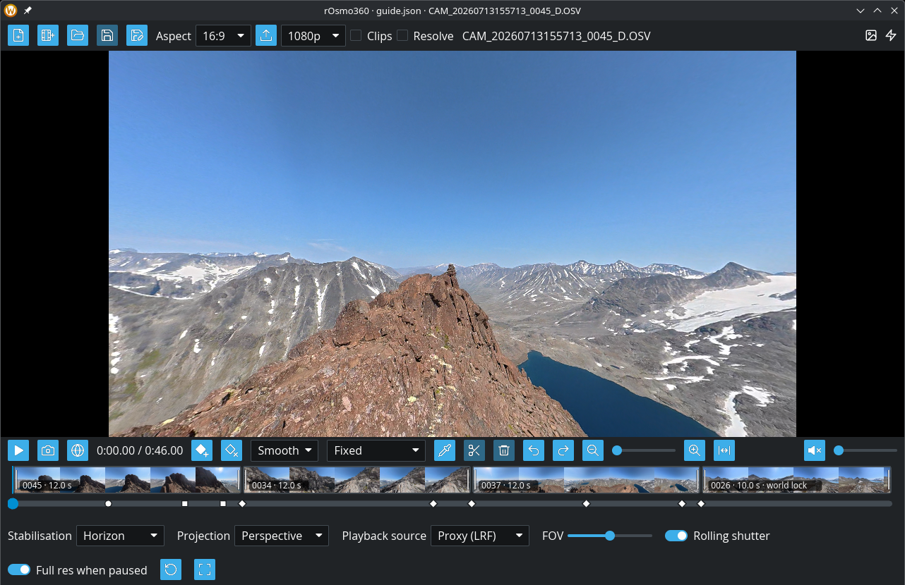

# rOsmo360

A 360° video player and editor for **DJI Osmo 360** footage, written in Rust. It plays the camera's `.OSV` files directly: it stitches the two fisheye lenses, stabilises with the camera's gyro data and lets you look around freely, without going through DJI Studio. Then you can cut clips together on a timeline, keyframe the camera's view, and export a framed video.



**New here? Read the [user guide](docs/user-guide.md)**: the whole app, step by step, with screenshots.

Licensed under [MIT](LICENSE-MIT) or [Apache-2.0](LICENSE-APACHE), at your option.

Ready-made Linux builds, with an install script and an AppImage, are on the [releases page](https://github.com/ravelund/rOsmo360/releases/latest); see [Installing](#installing).

## Why

I vibed this tool primarily for Linux, since I couldn't find anything close to DJI Studio there. The goal of rOsmo360 is to bring most of DJI Studio's playback and editing to Linux users. It isn't Linux-exclusive, though: Windows and macOS support is in the pipeline.

## Features

### Playing

- **Stitching** with DJI's own calibration, read from each clip. Per frame it also:
  - evens out the two lenses' exposure along the seam;
  - shifts the lenses to line up close subjects, such as the hand on a selfie stick, so they don't ghost.
  - fades each lens out smoothly where DJI's masks hide the selfie stick, so sun glare in one lens leaves no line in the sky.
- **Stabilisation** from the camera's built-in 1 kHz motion data, with rolling-shutter correction:
  - **Horizon**: a level horizon that follows where you point the camera.
  - **Level**: a level horizon that stays pointing one way in the world while the camera turns.
  - **World lock**: the view stays fixed in the world, tilt included.
- **Free look**: drag to look around, scroll to zoom, and roll the view.
- **Projections**: little planet (the default, like DJI Studio), perspective and flat equirectangular.
- **Smooth playback** from the low-resolution proxy (`.LRF`), switching to the full-resolution frame when paused. On a fast GPU it can stream the full-resolution `.OSV` directly.
- **Hardware decoding** on any GPU vendor: Vulkan Video, VA-API or CUDA, with a software fallback.
- **Sound**, in sync with the picture, with mute and volume.
- **Save photos** of a paused frame: the view as framed, at 3840 px on the long side, or the whole 360° sphere at 7680 × 3840.
- **Aspect lock** (16:9, 9:16, 4:3, 1:1, 2:1) for framing shots; saved views and exports take the same shape.
- **Looks native**: follows your desktop's colour theme (KDE, GNOME, Windows, macOS), including live changes. Your settings are remembered between runs.

### Editing

- **Timeline** of cuts from one or more clips: split, trim, move and delete them, with undo and redo. Each cut shows thumbnails of its footage, and the timeline zooms in for fine work.
- **Keyframes** for the view: where it looks (yaw, pitch, roll), the zoom, and the projection, so a shot can pan, zoom or morph into a little planet. Each keyframe eases into the next smoothly, at a steady speed, or holds and then cuts.
- **Follow the stick**: a keyframe can follow the selfie stick, and so whoever holds it, for a third-person shot that frames you automatically. It works from the camera's motion data, even straight below the camera.
- **Follow a subject by colour**: `rosmo360 track` finds a coloured subject (a friend's jacket, a tent) through a clip, and keyframes can follow it the same way.
- **Stabilisation per cut**: one cut world-locked, the next following the horizon.
- **Projects**: save the edit and open it again later. A cut can carry a short note, shown on the timeline.
- **Export** the edit to MP4 with its sound, from 720p to 4K, in the aspect lock's shape. It renders on the GPU, about four times faster than the CPU (21 frames a second at 1080p on an RTX 3090).
- **Export for another editor**: a file per cut (`My hike - 001.mp4`, `- 002` …), and a DaVinci Resolve format (DNxHR HQ with PCM sound in `.mov`) that Resolve's free Linux version can read.

### Command line

- **Export** a clip with a fixed view or keyframed camera moves, or a whole project, in any shape such as 9:16.
- **Skim clips**: contact sheets of stitched frames (of a clip, or of a project with a row per cut), and a per-second summary of the camera's motion and the sound level.
- Stitch single frames or whole clips to equirectangular images and MP4 video.

## Requirements

- A DJI Osmo 360 clip (`.OSV`). Keep the `.LRF` proxy file next to it for the smoothest playback.
- `ffmpeg` and `ffprobe` on your `PATH`.
- A GPU with Vulkan support (Linux) and up-to-date drivers. It plays, decodes and exports.
- On Linux, ALSA for sound (`alsa-lib`, or `libasound2-dev` on Debian/Ubuntu). PipeWire and PulseAudio work through it.
- To build: Rust 1.88 or newer.

Developed and tested on Linux (KDE Plasma, NVIDIA RTX 3090). Windows and macOS builds are planned but not yet tested.

## Installing

Ready-made builds for x86_64 Linux are on the [releases page](https://github.com/ravelund/rOsmo360/releases/latest). They run on Ubuntu 22.04, Debian 12, Fedora 36 and newer distributions. Install `ffmpeg` from your distribution first; the builds use it, and its GPU decoders, from the system.

- **Install script**: puts `rosmo360` in `~/.local/bin` and adds rOsmo360 to the application menu.

  ```sh
  curl -fsSL https://github.com/ravelund/rOsmo360/releases/latest/download/install.sh | sh
  ```

  Or download `rosmo360-x86_64-linux.tar.gz`, unpack it and run `./install.sh` in it. `--prefix /usr/local` (as root) installs for all users, and `--uninstall` removes it again.
- **AppImage**: download `rOsmo360-x86_64.AppImage`, make it executable (`chmod +x`) and run it. Without arguments, or given clips or a project, it opens the player. Commands work as with `rosmo360`: `./rOsmo360-x86_64.AppImage export clip.OSV -o out.mp4`.

## Building

```sh
cargo build --release
```

The program is `target/release/rosmo360`. `packaging/build-release.sh` builds the release files into `dist/`, inside an Ubuntu 22.04 container (docker), so they run on older distributions too.

## Usage

The **[user guide](docs/user-guide.md)** walks through the whole app with screenshots: watching, projections, stabilisation, the timeline, keyframes, projects and exporting.

```sh
rosmo360 play                 # opens the player; use Open clips… or Ctrl+O
rosmo360 play clip.OSV        # opens a clip straight away
rosmo360 play a.OSV b.OSV     # several clips, one after another on the timeline
rosmo360 play edit.json       # a saved project
```

In the player:

| Action | How |
|---|---|
| Look around | Drag (right-drag or Q/E rolls) |
| Zoom | Scroll, or `+` / `-` |
| Play / pause | Space |
| Seek | Drag the seek bar, or ← / → for 5 s |
| Step one frame (paused) | `,` and `.` |
| Stabilisation (of the playing cut) / projection | S / P |
| Rolling-shutter correction | R |
| Mute | M |
| Reset view / fullscreen | 0 / F |
| Keyframe the current view | K, or the ◆+ button (on a keyframe, it updates it) |
| Jump to the previous / next keyframe | `[` / `]`, or click a ◆ on the timeline |
| Move / delete a keyframe | Drag its ◆ / Delete |
| How a keyframe moves on to the next | J cycles, or the Ease picker: smooth (◆), linear (●) or hold (■, stays put then cuts) |
| Make a keyframe follow the selfie stick or a subject | The Follow picker: Fixed, Stick, or Colour track (its mark gets a ring); for a colour track, the eyedropper: drag a box over the subject (a jacket, a tent) and it's tracked to the end of the cut |
| Keep the horizon level and the heading fixed | S to **level**: a keyframe's yaw is then a direction in the world, so a view stays on a summit through a pan |
| Zoom the timeline | Scroll on it (around the pointer), Ctrl+= / Ctrl+−, or the 🔍 buttons and slider; Ctrl+0 or ⟷ shows the whole edit |
| Scroll the zoomed timeline | Shift+scroll or a sideways scroll on it, or drag the bar under it; it follows the playhead while playing |
| Add clips to the edit | The film strip with a plus (Ctrl+O); several at once is fine |
| Split the cut at the playhead | C, or ✂ |
| Trim / move a cut | Drag its edge / drag the cut on the timeline |
| Delete the selected cut | Shift+Delete, or 🗑 |
| Undo / redo | Ctrl+Z / Ctrl+Shift+Z |
| Save / open / new project | Ctrl+S (Ctrl+Shift+S: save as) / Ctrl+Shift+O / Ctrl+N |
| Export the edit | The export button, an arrow out of a tray (pick 720p–2160p next to it); the aspect lock sets the shape, 16:9 when free. **Clips** writes each cut to its own file ("project - 001" and on) for another editor; **Resolve** writes DNxHR and PCM in `.mov`, which DaVinci Resolve's free Linux version can read |

A project saves the cuts, their keyframes and the aspect lock, in the same file `rosmo360 export` renders (see below). Clips in the project's folder are stored by relative path, so the folder can be moved as a whole.

Command-line tools:

```sh
rosmo360 stitch clip.OSV -t 10 -w 4096 --stabilize horizon -o frame.png   # one frame to an equirect PNG
rosmo360 render clip.OSV -s 48 -d 12 -w 3840 --stabilize horizon -o out.mp4   # a span to an equirect MP4
```

Framed video:

```sh
rosmo360 export clip.OSV -s 30 -d 8 --view 40,-10 -a 9:16 -o reel.mp4   # a fixed view: yaw 40°, pitch −10°, vertical
rosmo360 export clip.OSV --reframe moves.json -o reel.mp4                         # keyframed camera moves
rosmo360 export clip.OSV --reframe moves.json --draft -o draft.mp4                # quick, soft draft from the proxy
```

Export stitches on the GPU with the player's shader (any vendor, through wgpu): about 21 frames a second at 1080p on an RTX 3090, four times the CPU stitcher. `--cpu` uses the CPU stitcher instead, as happens anyway without a usable GPU.

Angles are in degrees: yaw turns right, pitch looks up. With stabilisation on (horizon, the default), yaw 0 is straight ahead. A reframe file lists keyframes; each may leave out what stays the same:

```json
{
  "aspect": "9:16",
  "keyframes": [
    {"t": 28, "yaw": -20, "pitch": -5, "fov": 80},
    {"t": 32, "yaw": 100, "pitch": -15, "fov": 70},
    {"t": 34},
    {"t": 37, "projection": "little-planet", "pitch": -90, "fov": 130}
  ]
}
```

Exports are 1080p by default (1920 × 1080, or 1080 × 1920 for 9:16), a good quality for sharing online. `-r` picks `720p`, `1080p`, `1440p` or `2160p` (`4k`), meaning the short side in pixels. `-a` sets the shape (`16:9`, `9:16`, `1:1`, `4:5`, …) when the reframe file doesn't, and `--size 1234x567` gives an exact size.

To join cuts from one or more clips, write a project file and export it. Each cut has its own keyframes, in clip time, and may set its own `stabilize` (`off`, `horizon`, `level` or `lock`; otherwise `--stabilize`, horizon by default) and a `note`, which the player's timeline shows on the cut. Relative paths are relative to the project file:

```json
{
  "aspect": "9:16",
  "cuts": [
    {"input": "CAM_0037.OSV", "in": 28, "out": 32, "keyframes": [{"t": 28, "yaw": -20}, {"t": 32, "yaw": 60}]},
    {"input": "CAM_0043.OSV", "in": 5, "out": 8, "stabilize": "lock", "note": "the wave"},
    {"input": "CAM_0037.OSV", "in": 34, "out": 37, "keyframes": [{"t": 37, "projection": "little-planet", "pitch": -90}]}
  ]
}
```

```sh
rosmo360 export edit.json -o edit.mp4
rosmo360 export edit.json --clips --handles 1 -o clips/      # a file per cut: "edit - 001.mp4", … with 1 s extra either side
rosmo360 export edit.json --format resolve -o edit.mov       # DNxHR HQ + PCM, for DaVinci Resolve on Linux
```

`--format resolve` exists because DaVinci Resolve's free version on Linux reads neither H.264/H.265 nor AAC. DNxHR is an editing format, so the files are large: about 27 MB a second at 1080p.

`t` is the clip time in seconds; `projection` is `perspective`, `little-planet` or `equirect`; `ease` (how a keyframe moves on to the next) is `smooth` (the default), `linear` or `hold`. Perspective and little planet morph smoothly into each other.

Instead of `yaw` and `pitch`, a keyframe can say `"follow": "stick"`: it then looks along the selfie stick, at whoever holds it, plus `offset_yaw` and `offset_pitch` (degrees). For a third-person shot from above and behind, try `{"t": 30, "follow": "stick", "offset_pitch": 25, "fov": 100}`. Following carries on to the next keyframes until one gives its own `yaw` and `pitch`.

To follow something else, track it by colour first, then give the track's file as `follow` (relative to the project or reframe file):

```sh
rosmo360 track clip.OSV --colour "#e8641e" -s 12 -d 15 > friend.csv   # --near YAW,PITCH where it starts, if it isn't the biggest patch of that colour
```

```json
{"t": 12, "follow": "friend.csv", "offset_pitch": 10, "fov": 80}
```

The CSV has, every 0.1 s, the subject's direction in the camera, its yaw and pitch as world directions (as in `--stabilize level` and `scan`'s heading) and its size; empty rows where it was lost. Pick a colour that stands out: the sky, grass and rock won't do.

Skimming a clip:

```sh
rosmo360 info clip.OSV                      # length, frame rate, recording time, as JSON
rosmo360 preview clip.OSV -o sheet.png      # 24 moments on one contact sheet, marked with time and yaw
rosmo360 preview clip.OSV --reframe moves.json -o check.png   # the framing at each keyframe
rosmo360 preview edit.json -o check.png      # a project: a row per cut, framed as the export (--every N for more)
rosmo360 scan clip.OSV > scan.csv           # per second: heading, tilt, turning, shake, loudness
rosmo360 scan clip.OSV --image > scan.csv   # and open sky, skyline height, views out to the horizon
```

Clips' telemetry and thumbnails are cached in `~/.cache/rosmo360`, so a clip opens in a fraction of a second after the first time (0047 from a network share: 46 s, then 0.4 s). `rosmo360 cache add FOLDER` caches a folder's clips ahead of time, `rosmo360 cache move FOLDER` keeps the cache elsewhere (or set `ROSMO360_CACHE` for one run), `rosmo360 cache` shows where it is and its size, `rosmo360 cache clear [--older-than DAYS]` empties it, and `--no-cache` on any command bypasses it.

`rosmo360 --help` lists everything, including `rig` (calibration as JSON), `imu` (motion data as CSV) and `seam` (seam quality report).

## Roadmap

- Version 0.3: crossfades between cuts, and sound controls (a music track and each cut's volume).
- 360° metadata on equirectangular exports, so YouTube and VR players show them as 360° video.
- Smooth full-resolution playback on modest hardware (zero-copy decoding).
- Windows and macOS builds.
- D-Log M colour support.

## License

rOsmo360 is licensed under either of

- the [MIT License](LICENSE-MIT), or
- the [Apache License, Version 2.0](LICENSE-APACHE),

at your option. Unless you state otherwise, any contribution you submit for inclusion in rOsmo360 is dual-licensed as above, without any additional terms or conditions.

The Vibing with Ravelund logo ([`vibewithravelund-lowres-corrected.jpg`](vibewithravelund-lowres-corrected.jpg)) and the screenshots ([`docs/screenshot.png`](docs/screenshot.png) and those in [`docs/guide/`](docs/guide/)) are not covered by these licences; all rights reserved.

## Support

rOsmo360 is free, and it always will be. If you find it useful and feel like buying me a coffee, you can do that through [PayPal](https://www.paypal.com/donate/?hosted_button_id=78BF2LSB8FGR8). Thank you! ☕

## Credits

Made by **Vibing with Ravelund**, 2026. rOsmo360 was built through AI-assisted ("vibe") coding with Claude.

It stands on the shoulders of:

- [telemetry-parser](https://github.com/AdrianEddy/telemetry-parser) by Adrian Eddy, which reads the camera's calibration and motion data;
- [iced](https://iced.rs) (GUI), [wgpu](https://wgpu.rs) (GPU rendering), [cpal](https://github.com/RustAudio/cpal) (sound), [native-theme](https://github.com/tiborgats/native-theme) (desktop theming) and [rfd](https://github.com/PolyMeilex/rfd) (file dialogs);
- [FFmpeg](https://ffmpeg.org), used as an external program for decoding.

rOsmo360 is an independent project. It is not affiliated with or endorsed by DJI. DJI, Osmo and DJI Studio are trademarks of SZ DJI Technology Co., Ltd.
