# rOsmo360 user guide

rOsmo360 plays and edits 360° video from the **DJI Osmo 360**. It reads the camera's `.OSV` files directly, stitches the two lenses, keeps the horizon level, and lets you look around, cut clips together, keyframe the camera's view and export a finished video.

This guide walks through the whole app. For building it, see the [README](../README.md).

**Contents**

1. [Getting started](#1-getting-started)
2. [The window](#2-the-window)
3. [Watching a clip](#3-watching-a-clip)
4. [Projections](#4-projections)
5. [Stabilisation](#5-stabilisation)
6. [Building an edit on the timeline](#6-building-an-edit-on-the-timeline)
7. [Keyframes: moving the camera](#7-keyframes-moving-the-camera)
8. [Framing: the aspect lock](#8-framing-the-aspect-lock)
9. [Projects](#9-projects)
10. [Exporting video](#10-exporting-video)
11. [Saving photos](#11-saving-photos)
12. [The command line](#12-the-command-line)
13. [Keyboard shortcuts](#13-keyboard-shortcuts)
14. [Tips and troubleshooting](#14-tips-and-troubleshooting)

---

## 1. Getting started

You need:

- Clips from the Osmo 360 (`.OSV`). Copy the `.LRF` file that the camera records next to each clip as well. It's a small preview version, and rOsmo360 uses it for smooth playback, scrubbing and thumbnails.
- `ffmpeg` and `ffprobe` installed and on your `PATH`.
- A GPU with up-to-date drivers (Vulkan on Linux). It decodes the video, draws the view and renders exports.

Start the app with `rosmo360 play`. You can also name what to open:

```sh
rosmo360 play                  # the start screen
rosmo360 play clip.OSV         # one clip
rosmo360 play a.OSV b.OSV      # several clips, one after another on the timeline
rosmo360 play edit.json        # a saved project
```

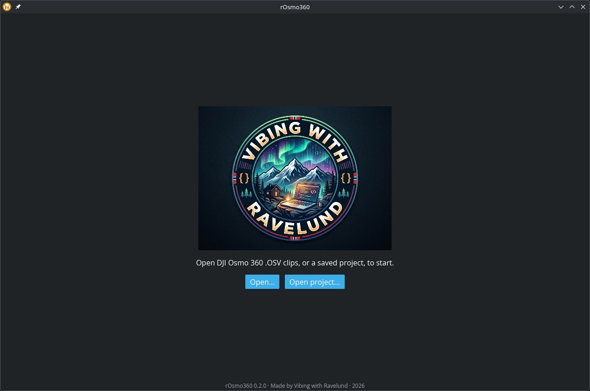

On the start screen, **Open…** picks one or more clips and **Open project…** opens a saved edit. The first clip starts playing as soon as it has loaded.

## 2. The window

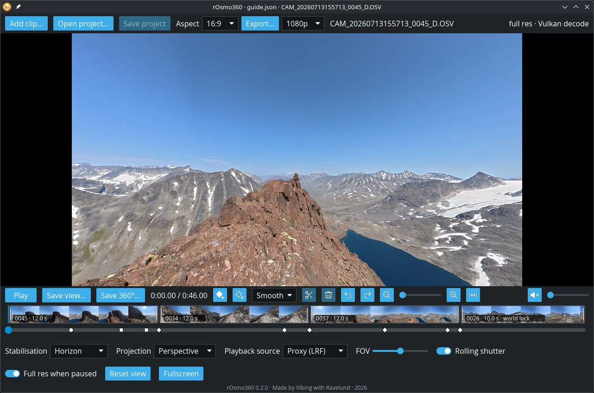

From top to bottom:

1. **The top bar**: adding clips, projects, the export shape and resolution, and what is playing.

   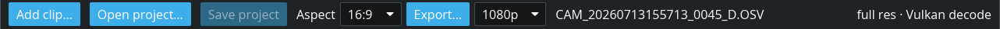

   On the right it says what you're seeing ("proxy", "OSV 1920 px" or "full res") and which decoder is in use. After an export it says where the file went.

2. **The view**, where you look around.

3. **The transport row**: play, photos, the time, keyframe and cut tools, timeline zoom, and sound.

   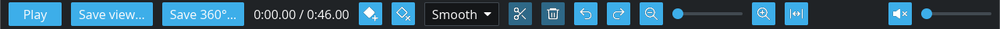

4. **The timeline**: the cuts of your edit, with thumbnails, and below them the seek bar with the keyframes.

   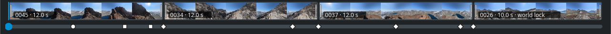

5. **The settings row**: stabilisation, projection, playback source, field of view, rolling-shutter correction, and full resolution when paused.

   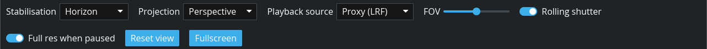

Hover over any button to see what it does and its shortcut.

## 3. Watching a clip

| To | Do |
|---|---|
| Play or pause | Space, or **Play** |
| Seek | Click or drag on the seek bar; ← / → jump 5 seconds |
| Step one frame (paused) | `,` and `.` |
| Look around | Drag in the view, or use ↑ / ↓ (pitch) and Shift+← / → (yaw) |
| Roll the view | Right-drag, or Q / E |
| Zoom | Scroll in the view, `+` / `-`, or the **FOV** slider |
| Go back to the starting view | 0 or Home, or **Reset view** |
| Fullscreen | F, or **Fullscreen**; Esc leaves it |
| Mute | M, or the speaker button; the slider sets the volume |

**Playback source.** Clips play from the `.LRF` proxy by default. It decodes quickly, so playback and scrubbing stay smooth on most computers. On a fast GPU you can play the `.OSV` itself, scaled to 1920 px or at its full 3840 px. If there's no `.LRF`, the `.OSV` is used.

**Full res when paused.** When this is on, pausing swaps in a sharp full-resolution frame after a moment. Turn it off to keep the paused picture at the playback source's quality. The picture then doesn't jump in sharpness while you set keyframes. Exports always use the full resolution either way.

## 4. Projections

Press **P**, or use the **Projection** picker, to switch between three ways of showing the sphere.

**Perspective** is a normal camera view: straight lines stay straight. It's the one for most shots.

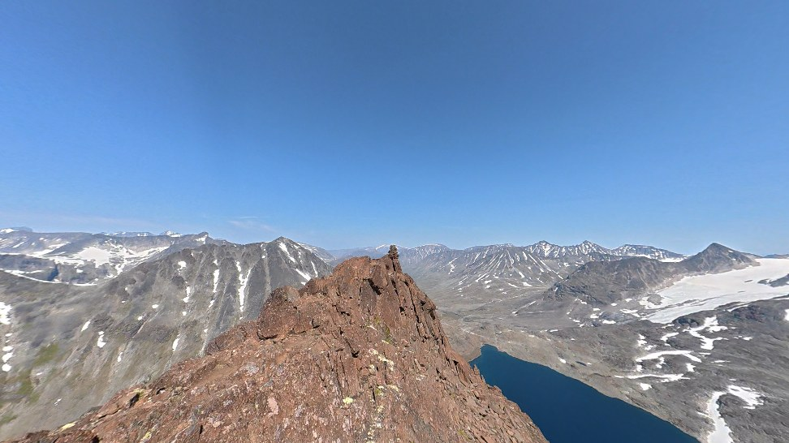

**Little planet** wraps the whole sphere into a circle. Looking down (the default) makes a tiny planet with the ground in the middle. Looking up turns it inside out, with the sky in the middle and the landscape around it:

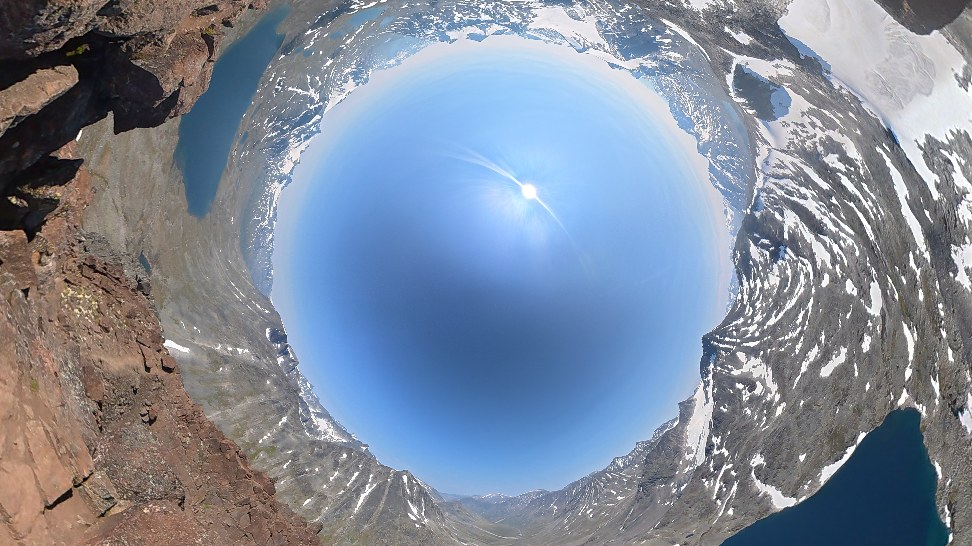

**Equirect** shows the whole sphere flat, as a 2:1 map. It's useful for seeing everything that's around at once.

Perspective and little planet are one family. A keyframed move can morph smoothly from one into the other (see [keyframes](#7-keyframes-moving-the-camera)).

## 5. Stabilisation

The camera records its own motion about a thousand times a second, and rOsmo360 uses that to steady the picture.

- **Horizon** (the default) keeps the horizon level and follows where the camera points, smoothed. It looks like a steady camera operator.
- **World lock** holds the view still in the world, wherever the camera turns. A mountain stays put while the camera spins. It keeps the clip's starting orientation, including any tilt it started with.
- **Off** shows the picture as the camera saw it.

Press **S**, or use the **Stabilisation** picker. **Each cut keeps its own mode**: the picker changes the cut that's playing, and new cuts get the mode you used last. On the timeline, a cut that isn't on horizon says so in its label, for example "world lock".

**Rolling shutter** (R) corrects the slight wobble and lean caused by the sensor reading out line by line during fast turns. Leave it on.

## 6. Building an edit on the timeline

An *edit* is a row of *cuts*, each a stretch of one clip, played one after another. Every clip you open becomes a cut.

- **Add clips**: **Add clip…** or Ctrl+O; you can pick several at once. Each is added at the end.
- **Select a cut**: click it in the top row of the timeline.
- **Split**: put the playhead where you want the cut, then press **C** or ✂. Both halves keep the cut's keyframes, so the camera move carries on unchanged.
- **Trim**: drag a cut's left or right edge.
- **Move**: drag a cut sideways; a line shows where it will land.
- **Delete**: select it and press **Shift+Delete**, or 🗑.
- **Undo / redo**: Ctrl+Z and Ctrl+Shift+Z (or Ctrl+Y).

Playback runs through the cuts in order. At the end of one cut it carries on into the next, even when the next one comes from a different clip.

Each cut shows thumbnails of its footage, the view straight ahead. They fill in a moment after a clip loads; a long clip takes a few seconds.

### Zooming the timeline

With a long edit, short cuts and close keyframes get narrow. Zoom in:

- **Scroll** on the timeline to zoom around the mouse pointer.
- **Ctrl+=** / **Ctrl+−**, or the 🔍 buttons and the slider between them, zoom around the playhead.
- **Ctrl+0**, or ⟷, shows the whole edit again.

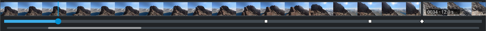

When zoomed in, a scrollbar appears under the seek bar. Drag it, use Shift+scroll, or scroll sideways on a touchpad to move along. While playing, the timeline scrolls along to keep the playhead in sight.

## 7. Keyframes: moving the camera

A **keyframe** remembers a view at a moment of a cut: where it looks (yaw, pitch, roll), the zoom, and the projection. Between keyframes the view moves smoothly from one to the next. That's how you make pans, slow zooms and morphs into a little planet.

1. Go to the moment where the move should start, and frame the view.
2. Press **K**, or the ◆+ button. A mark appears on the seek bar.
3. Go to where the move should end, frame the new view, and press **K** again.
4. Play it back.

More:

- **Update a keyframe**: go to it and press K again with the new view.
- **Jump between keyframes**: `[` and `]`, or click a mark.
- **Retime a keyframe**: drag its mark along the seek bar.
- **Delete a keyframe**: go to it and press **Delete**, or the ◆× button.

**Following and looking.** After you play, seek or change a keyframe, the view follows the keyframes. As soon as you look around by hand, you take over from the view they showed, until the next play or seek. So you can always look around freely without changing anything; only K saves a view.

Keyframes belong to their cut and stay pinned to the footage. Moving or trimming a cut keeps its camera moves on the same moments. Keyframes trimmed off the end are kept for when you extend the cut again.

### Ease: how a keyframe moves on

Each keyframe also says how the view travels from it to the *next* one. Choose it in the **Ease** picker while the playhead is on the keyframe, or press **J** to cycle through the three:

| Ease | Mark | From this keyframe to the next |
|---|---|---|
| **Smooth** | ◆ | Starts gently, moves, and slows into the next keyframe. The default; good for most moves. |
| **Linear** | ● | Moves at a steady speed. Good for an even pan, or for several keyframes in a row that should feel like one move. |
| **Hold** | ■ | Stays still, then jumps to the next keyframe's view when the playhead gets there. A cut to a new angle within one cut. |

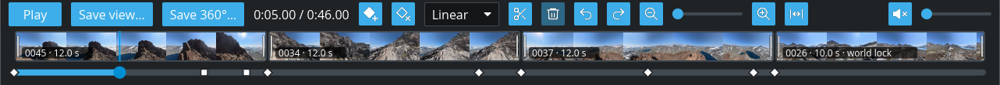

Two common patterns:

- **Pause, then pan**: two keyframes with the same view (the first Smooth or Hold), then a third with the new view.
- **Cut between angles**: set a keyframe to Hold, and put the next keyframe, with the other angle, where the cut should happen.

## 8. Framing: the aspect lock

The **Aspect** picker in the top bar sets the shape of the picture: Free, 16:9, 9:16, 4:3, 1:1 or 2:1. The view is letterboxed to that shape, so you frame exactly what will be exported. Use 9:16 for phone video such as Reels, Shorts or TikTok:

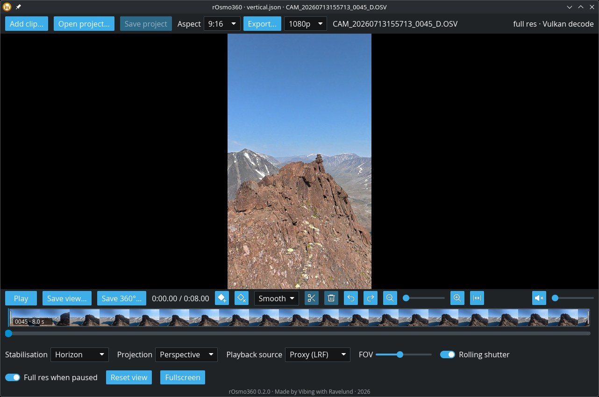

Exports and saved views take the same shape. With **Free**, exports are 16:9.

## 9. Projects

A project saves the edit: the cuts, their keyframes and stabilisation, and the aspect lock.

- **Save**: Ctrl+S, or **Save project**. **Save as**: Ctrl+Shift+S.
- **Open**: Ctrl+Shift+O, or **Open project…**. You can also give the file to `rosmo360 play edit.json`.

The window title shows the project's name, with a dot (•) when there are unsaved changes. If you close the window or open another project with unsaved changes, rOsmo360 asks whether to **Save**, **Don't save** or **Cancel**.

Projects are small JSON files. Clips in the project's folder, or in folders inside it, are saved by relative path, so you can move the whole folder, or copy it to another computer, and the project still finds its clips. If a clip is missing when you open a project, its cuts are left out and you're told which.

## 10. Exporting video

1. Pick the resolution next to **Export…**: 720p, 1080p (the default, good for sharing online), 1440p or 2160p (4K). It's the short side of the picture, so 1080p is 1920 × 1080 for 16:9, or 1080 × 1920 for 9:16.
2. Set the shape with the **Aspect** picker.
3. Click **Export…** and choose where to save the MP4.

The export renders the whole edit at full resolution, with the sound joined across the cuts. Each cut uses its own keyframes and stabilisation, and the export follows the rolling-shutter setting. Progress shows in the top bar, with **Cancel** to stop; a cancelled export leaves no half-finished file.

Exports render on the GPU. On an RTX 3090 that's about 21 frames a second at 1080p, so a one-minute edit takes about a minute and a half. You can keep using the player while it runs.

## 11. Saving photos

Pause, then:

- **Save view…** saves what you see as a PNG, 3840 px on the long side, in the aspect lock's shape.
- **Save 360°…** saves the whole sphere as a 7680 × 3840 equirectangular PNG. Most photo sites and viewers that support 360° photos can show it.

Both are rendered from fresh full-resolution frames, which takes a few seconds.

## 12. The command line

Everything the player exports can also be made from a terminal, which is handy for batches or scripts. `rosmo360 --help` and `rosmo360 <command> --help` list all the options.

**Export** a project, or a clip with a fixed or keyframed view:

```sh
rosmo360 export edit.json -o edit.mp4                         # a project saved from the player
rosmo360 export clip.OSV -s 30 -d 8 --view 40,-10 -a 9:16 -o reel.mp4
rosmo360 export clip.OSV --reframe moves.json -r 2160p -o reel.mp4
rosmo360 export edit.json --draft -o draft.mp4                # quick and soft, from the proxies
```

**Preview** an edit or a clip as one image. For a project you get a row per cut, each tile framed as the export will frame it:

```sh
rosmo360 preview edit.json --every 2 -o check.png
rosmo360 preview clip.OSV -o sheet.png                        # 24 moments of a clip, the whole sphere
```

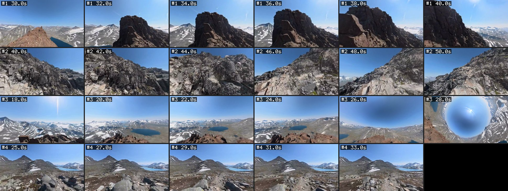

**Find good moments**: `rosmo360 scan clip.OSV > scan.csv` gives, per second, where the camera points, how fast it turns or shakes, and how loud it is. `rosmo360 info clip.OSV` prints the clip's length, frame rate and recording time.

**Stitch** whole clips or frames to equirectangular video or images, for other 360° tools:

```sh
rosmo360 render clip.OSV -s 48 -d 12 -w 3840 --stabilize horizon -o out.mp4
rosmo360 stitch clip.OSV -t 10 -w 4096 --stabilize horizon -o frame.png
```

The [README](../README.md#usage) describes the project and reframe file formats.

## 13. Keyboard shortcuts

| Key | Action |
|---|---|
| Space | Play / pause |
| ← / → | Seek 5 seconds |
| `,` / `.` | Step one frame back / forward (paused) |
| ↑ / ↓ | Look up / down |
| Shift+← / → | Look left / right |
| Q / E | Roll left / right |
| `+` / `-` | Zoom in / out |
| 0 or Home | Reset the view |
| P | Next projection |
| S | Next stabilisation mode (for the playing cut) |
| R | Rolling-shutter correction on / off |
| M | Mute |
| F / Esc | Fullscreen / leave fullscreen |
| K | Add a keyframe here, or update the one here |
| J | Cycle the keyframe's ease: smooth, linear, hold |
| `[` / `]` | Previous / next keyframe |
| Delete | Delete the keyframe here |
| C | Split the cut at the playhead |
| Shift+Delete | Delete the selected cut |
| Ctrl+Z / Ctrl+Shift+Z (Ctrl+Y) | Undo / redo |
| Ctrl+= / Ctrl+− | Zoom the timeline in / out |
| Ctrl+0 | Show the whole edit on the timeline |
| Ctrl+O | Add clips |
| Ctrl+S / Ctrl+Shift+S | Save the project / save as |
| Ctrl+Shift+O | Open a project |

With the mouse: drag in the view to look around, right-drag to roll, scroll to zoom. On the timeline, click to seek, click a keyframe mark to jump to it, drag a mark to retime it, drag a cut to move it or its edges to trim it, and scroll to zoom.

## 14. Tips and troubleshooting

- **Playback stutters.** Use the **Proxy (LRF)** source; it needs far less than the full `.OSV`. If a clip has no `.LRF`, copy it from the camera's card; DJI records one next to every clip.
- **Clips load slowly the first time.** Each clip is checked for its calibration and motion data, and the GPU decoder is tested once. Video on a spinning hard drive is slower to start and scrub than on an SSD.
- **The paused picture keeps changing sharpness.** Turn off **Full res when paused** while keyframing.
- **Something close to the camera looks doubled or cut at the edges.** That's the seam where the two lenses meet. rOsmo360 lines up close subjects and cuts cleanly where it can't, but a hand or face very close to the seam can still show it. Turn the view so close subjects sit away from the sides of the camera.
- **"World lock" starts tilted.** It holds the clip's first orientation. Start the cut where the camera is level, or use horizon.
- **No sound.** Check the speaker button isn't muted. On Linux, sound goes through ALSA, which PipeWire and PulseAudio both provide.
- **Export says it's stitching on the CPU.** No usable GPU was found, so it falls back to the slower CPU stitcher. Update your GPU drivers. The result looks the same.
- **Your settings** (stabilisation, playback source, rolling shutter, full res when paused, volume, export resolution and aspect) are remembered between runs, in `~/.config/rosmo360/settings.json` on Linux.
